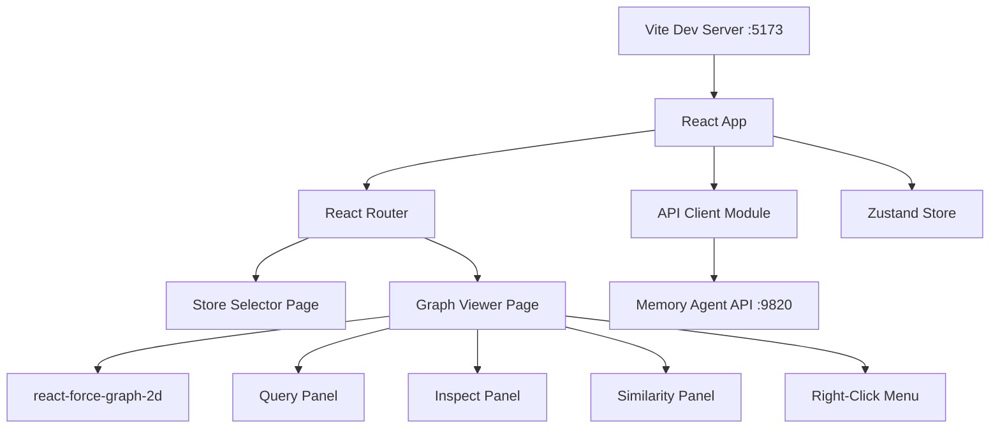

# Memory Viewer — Web Application Plan

## Architecture




## Tech Stack

- **Framework**: React 19 + TypeScript + Vite
- **Graph Visualization**: `react-force-graph-2d` — Canvas-based force-directed graph with custom `nodeCanvasObject` for glow sprites (shadow blur + radial gradients on Canvas2D)
- **Styling**: Tailwind CSS v4 with custom slate-blue theme, Lexend font (Google Fonts)
- **State Management**: Zustand — lightweight, holds connection state, graph data, selected node, query results
- **Routing**: React Router v7 — two routes: `/` (store selector) and `/graph/:workspaceId` (viewer)
- **HTTP Client**: Thin wrapper around `fetch` with JWT token management

## API Integration Map

The viewer operates as an **admin client** (scope `memory:admin`). Key endpoints used:


| Viewer Feature         | API Endpoint                                                           | Purpose                         |
| ---------------------- | ---------------------------------------------------------------------- | ------------------------------- |
| Store selector grid    | `GET /admin/graphs`                                                    | List all workspaces with stats  |
| Graph rendering        | `GET /admin/graphs/{id}/subgraph`                                      | Nodes + edges for force layout  |
| Natural language query | `POST /admin/graphs/{id}/query` (`raw: false`)                         | LLM-synthesized answer          |
| Raw query              | `POST /admin/graphs/{id}/query` (`raw: true`)                          | Raw entities + relationships    |
| Similarity search      | `POST /admin/similarity/cross` or `POST /admin/graphs/{id}/similarity` | Find similar nodes/edges        |
| Node inspection        | Local from subgraph data + `GET /admin/graphs/{id}` for details        | Node metadata + connected edges |
| Auth                   | `POST /auth/token`                                                     | Obtain JWT for admin access     |


## File Structure

```
memory-viewer/
  docs/
    plan.md                    # This plan
    mocks/                     # The 5 mock images
  src/
    main.tsx                   # Entry point
    App.tsx                    # Router setup
    api/
      client.ts               # Auth + fetch wrapper (JWT management)
      types.ts                 # TypeScript types matching API response shapes
    stores/
      connection.ts            # Zustand: active workspace, token, connection state
      graph.ts                 # Zustand: nodes, edges, selected node, query results
    pages/
      StoreSelector.tsx        # Mock 1: grid of workspace cards
      GraphViewer.tsx          # Mock 2-5: main viewer layout
    components/
      graph/
        ForceGraph.tsx         # react-force-graph-2d wrapper with glow rendering
        NodeGlow.ts            # Custom nodeCanvasObject painter (glow sprites)
        GraphControls.tsx      # Zoom, reset, filter toggles
      panels/
        InspectPanel.tsx       # Mock 3: right-side node/edge detail panel
        QueryPanel.tsx         # Mock 4: search bar + results
        SimilarityPanel.tsx    # Mock 5: similarity search results + threshold controls
      ui/
        ContextMenu.tsx        # Right-click menu component
        FilterSidebar.tsx      # Left sidebar: node type toggles, edge richness slider, time range
        StatusBar.tsx          # Bottom bar: node/edge count, connection status
        WorkspaceCard.tsx      # Card component for store selector
    hooks/
      useGraphQuery.ts         # Query + subgraph fetching with loading states
      useSimilaritySearch.ts   # Similarity search hook
    styles/
      globals.css              # Tailwind imports, Lexend font, custom glow utilities
    lib/
      colors.ts                # Node type -> color mapping (cyan, violet, amber, emerald)
  index.html
  package.json
  vite.config.ts
  tailwind.config.ts
  tsconfig.json
```

## Screen-by-Screen Implementation

### Screen 1: Store Selector (`/`)

- On mount: call `POST /auth/token` with admin credentials (configured in env or a simple login form), then `GET /admin/graphs`
- Render grid of `WorkspaceCard` components from `graphs[]` response
- Each card shows: workspace name, entity_count, relation_count, last_updated, embedding/ingest model
- Card mini-graph thumbnail: a tiny `<canvas>` with random dots + lines, tinted per agent color
- Bottom: text input for custom URL + "Connect" button
- Clicking a card navigates to `/graph/{workspace}`

### Screen 2: Graph Viewer (`/graph/:workspaceId`)

- On mount: call `GET /admin/graphs/{id}/subgraph` (no query = full graph, capped by `max_nodes=200`)
- Render `react-force-graph-2d` with custom `nodeCanvasObject`:
  - Draw radial gradient circle with `ctx.shadowBlur` for glow effect
  - Color by `node.type` using the color map (Concept=cyan `#22d3ee`, Person=violet `#a78bfa`, Technology=amber `#fbbf24`, Pattern=emerald `#34d399`, Decision=rose `#fb7185`)
  - Size by `node.importance` (1-10 scale mapped to 4-16px radius)
  - Label below node in Lexend, light gray, small font
- Edges: semi-transparent lines, thickness from `edge.weight`, color interpolated from source node
- Left sidebar: `FilterSidebar` — type toggles filter nodes in/out, edge richness slider filters by weight, time range (future)
- Top bar: breadcrumb, search input (triggers query flow), settings
- Bottom: `StatusBar` with live counts

### Screen 3: Node Inspection (right-click on node)

- Right-click triggers `ContextMenu` positioned at cursor
- Menu items: Inspect Node, Similarity Search, Expand Neighbors, Show Connected Edges, Copy Node ID, Pin Node, Hide Node
- "Inspect Node" opens `InspectPanel` (slides in from right, ~350px)
  - Shows: node name, type badge (colored), description/summary, degree, importance
  - Connected nodes list with edge labels (from local graph data)
  - Source chunks (if `include_chunks` was true)
- "Similarity Search" triggers the similarity flow (Screen 5)
- "Expand Neighbors" re-queries the subgraph API with this node as query, deeper depth
- "Pin Node" sets `node.fx`/`node.fy` to lock position in force layout

### Screen 4: Query Results (search bar interaction)

- User types query in top search bar, presses Enter or clicks Search
- Toggle: "Raw / Natural Language" — controls `raw` param on `POST /admin/graphs/{id}/query`
- Simultaneously: re-query `GET /admin/graphs/{id}/subgraph?query=...` to get a query-scoped subgraph
- Split view: graph on left (query-relevant nodes bright, others ghosted via alpha), results panel on right
- Results panel shows:
  - If NL mode: synthesized answer text
  - If Raw mode: entity list with descriptions
  - Matched nodes with relevance bars (sorted by importance/degree from subgraph response)
- Ghosting: nodes NOT in the query subgraph get `globalAlpha = 0.15` in the canvas painter

### Screen 5: Similarity Search (from context menu or dedicated mode)

- Triggered from right-click > "Similarity Search" on a node
- Calls `POST /admin/graphs/{id}/similarity` with anchor `{ type: "entity", name: node.id }`
- Left sidebar switches to similarity controls: threshold slider (0-1), depth selector (1/2/3-hop), metric selector (display only — API uses cosine)
- Graph view: seed node centered with pulsing glow animation, other nodes positioned with similarity score affecting visual intensity
  - High similarity nodes: bright glow, close to center (we can weight the force layout link distance by `1 - similarity`)
  - Low similarity: dim, far out
  - Similarity score displayed below each node label
- Hovering an edge shows a floating tooltip card with edge description + similarity score

## Glow Rendering Detail

The key visual effect — glowing sprite nodes — is achieved in the `nodeCanvasObject` callback:

```typescript
const nodeCanvasObject = (node, ctx, globalScale) => {
  const r = (node.importance || 3) * 1.5;
  const color = typeColorMap[node.type] || '#94a3b8';
  
  // Outer glow via shadowBlur
  ctx.shadowBlur = 20;
  ctx.shadowColor = color;
  ctx.beginPath();
  ctx.arc(node.x, node.y, r, 0, 2 * Math.PI);
  ctx.fillStyle = color;
  ctx.fill();
  
  // Inner bright core
  ctx.shadowBlur = 0;
  ctx.beginPath();
  ctx.arc(node.x, node.y, r * 0.5, 0, 2 * Math.PI);
  ctx.fillStyle = '#ffffff';
  ctx.globalAlpha = 0.6;
  ctx.fill();
  ctx.globalAlpha = 1;
  
  // Label
  const label = node.summary || node.id;
  const fontSize = Math.max(10 / globalScale, 2);
  ctx.font = `${fontSize}px Lexend`;
  ctx.fillStyle = '#cbd5e1';
  ctx.textAlign = 'center';
  ctx.fillText(label, node.x, node.y + r + fontSize + 2);
};
```

## Color Palette


| Use                         | Color       | Hex       |
| --------------------------- | ----------- | --------- |
| Background (main)           | Slate 950   | `#0f172a` |
| Background (panels)         | Slate 800   | `#1e293b` |
| Background (cards)          | Slate 700   | `#334155` |
| Text primary                | Slate 100   | `#f1f5f9` |
| Text secondary              | Slate 400   | `#94a3b8` |
| Concept nodes               | Cyan 400    | `#22d3ee` |
| Person nodes                | Violet 400  | `#a78bfa` |
| Experiment/Technology nodes | Amber 400   | `#fbbf24` |
| File/Pattern nodes          | Emerald 400 | `#34d399` |
| Decision nodes              | Rose 400    | `#fb7185` |
| Accent/Interactive          | Blue 500    | `#3b82f6` |


## Implementation Order

Build in vertical slices so the app is usable at each step:

1. **Scaffold + Store Selector**: Vite + React + Tailwind + Router + API client + auth flow + the store selector page calling `GET /admin/graphs`
2. **Force Graph Core**: GraphViewer page with `react-force-graph-2d`, custom glow painter, node type colors, loading subgraph data from API
3. **Filter Sidebar + Status Bar**: Left panel with type toggles, edge weight slider; bottom status bar
4. **Right-Click + Inspect Panel**: Context menu on nodes, inspection panel with node details and connected edges
5. **Query Flow**: Search bar, Raw/NL toggle, query-scoped subgraph highlighting, results panel
6. **Similarity Search**: Similarity endpoint integration, threshold/depth controls, visual distance weighting
7. **Polish**: Animations, loading states, error handling, responsive layout, keyboard shortcuts

## Dev Environment

- `VITE_API_URL=http://localhost:9820` — Memory Agent gateway
- `VITE_ADMIN_SECRET=<secret>` — For auto-auth in dev (the admin shared secret)
- CORS already configured on the gateway for `localhost:5173`

