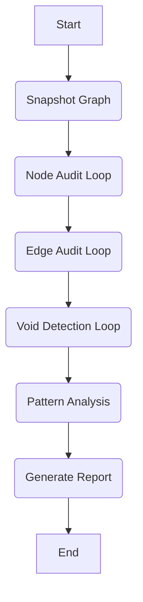

# System Design: Context Audit Utility ("The Deep Dive")
**Author**: Antigravity (Principal Engineer)
**Date**: 2026-01-10
**Status**: DRAFT
**Reference**: `00_Prompt_from_Brian.md`

## 1. Executive Summary
We will build a standalone CLI utility, `audit_context`, designed to perform a comprehensive "MRI Scan" of the Context Graph. It will introspect every node and edge, validate semantic consistency using an LLM, detect missing links via vector search, and generate a quality report with actionable metrics.

**Key Design Principle**: "Observation without Modification". This tool audits validity but does not auto-delete data (yet). It logs *everything* and tags metadata for later human or automated cleanup.

## 2. System Architecture

### 2.1 Components
-   **`ContextAuditor` (Orchestrator)**: Manages the pipeline phases and holds the in-memory graph snapshot.
-   **`AuditLogger`**: A specialized logger that buffers all LLM interactions in memory (cap 1GB) and flushes to disk only on completion/crash.
-   **`ConsistencyEngine`**: Validates `Node` internal logic (Type vs. Content).
-   **`RationaleEngine`**: Validates `Edge` logic (Narrative generation + "Does this make sense?").
-   **`VoidDetector`**: Identifies "False Negatives" (Missing edges between semantically close nodes).
-   **`PatternAnalyst`**: A meta-analysis layer that feeds error logs back to the LLM for high-level insight.

### 2.2 Data Flow


## 3. Implementation Details

### 3.1 Data Schema Extensions (Metadata)
We will utilize the existing `metadata` map on `ContextNode` and `ContextEdge` to store audit results. This allows the graph to carry its own "Health Score".

**Node Metadata keys:**
-   `audit_consistency_score`: "1.0" (Pass) or "0.0" (Fail).
-   `audit_consistency_reason`: LLM explanation.
-   `audit_timestamp`: ISO Date.

**Edge Metadata keys:**
-   `audit_rationale`: Generated narrative ("How A relates to B").
-   `audit_rationale_score`: "1.0" (Sensible) or "0.0" (Nonsense).
-   `audit_rationale_embedding`: Vector ID (pointing to auxiliary storage or encoded string if small).

### 3.2 The Pipeline Steps

#### Step 1: Full Introspection (Snapshot)
-   **Action**: Load *all* nodes/edges for a given participant into `InMemGraphStorage`.
-   **Safety**: If graph > 100k nodes, we stream. For now (prototype), memory load is acceptable.
-   **Log**: Initialize `audit.log` buffer.

#### Step 2: Node Consistency (The sanity check)
-   **Input**: Node Text, Type (e.g., "Ada Lovelace", Type: Project).
-   **Prompt**: *"Is '{name}' correctly classified as '{type}'? If not, what is it?"*
-   **Action**: Update `audit_consistency_score`. Track "False Positives" list.

#### Step 3: Edge Rationale (The "Why")
-   **Input**: Node A, Node B.
-   **Action**:
    1.  Query Context Manager with A & B embeddings to get 1-hop context.
    2.  **Prompt 1**: *"Given context X, explain the relationship between A and B."* -> Save as `Narrative`.
    3.  **Embed**: Vectorize `Narrative` (Store for future "Narrative Search").
    4.  **Prompt 2**: *"Is this relationship logical and strong?"* (Yes/No).
-   **KPI**: `EdgeRationalityRate`.

#### Step 4: Void Detection (The "Missed Connections")
-   **Input**: Every Node N.
-   **Action**:
    1.  Vector Search(N.embedding, limit=40).
    2.  Filter results where Edge(N, result) does NOT exist.
    3.  **Prompt**: *"Should {N} and {result} be connected? Why?"*
-   **KPI**: `EdgeFalseNegativeRate`.

#### Step 5: Meta-Analysis
-   **Input**: Top 100 discrepancies from Steps 2, 3, 4.
-   **Prompt**: *"Here are the errors found. Identify 3 systemic patterns (e.g., 'Historical figures misclassified as Projects')."*

## 4. Test Plan (Exhaustive)

We will create a specific test suite `context_audit_test/` to verify the *Auditor itself*.

### 4.1 Unit Tests (`AuditComponents.test.ts`)
1.  **Logger Capacity**: Verify `AuditLogger` drops old logs or warns when approaching 1GB (or rotates).
2.  **Consistency Logic**: Mock LLM to return "Invalid"; verify Node Metadata is updated correctly.
3.  **Rationale Logic**: Mock LLM to return "Nonsense"; verify Edge Metadata update + KPI decrement.
4.  **Void Logic**: Create 2 close vectors with no edge; verify `VoidDetector` flags them.

### 4.2 Integration Tests (`FullAudit.test.ts`)
1.  **Small Graph Run**: Create a 5-node graph (3 valid, 2 invalid). Run full audit.
2.  **Verify Report**: Check that markdown report is generated and contains expected error counts.
3.  **Idempotency**: Run audit twice. Ensure metadata updates (timestamps) but logic holds.

### 4.3 "The Golden Set" (Ground Truth)
-   **Input**: `brian_brewington.txt`.
-   **Setup**: Manually define 20 expected Q&A pairs (The "Golden Set").
-   **Test**: `GoldenSetValidator` script that asks the Context Manager these questions and uses an LLM-Judge to grade the answer against the golden answer.

## 5. Security & Safety
-   **Read-Only Default**: The tool defaults to *analyzing* and writing metadata, but NOT deleting nodes.
-   **Cost Guard**: Estimate token usage before run (Audit = N nodes * X tokens + M edges * Y tokens). Prompt user for confirmation if cost > $5.

## 6. Directory Structure
```
context_audit_test/
├── 01_context_audit_design.md
├── src/
│   ├── ContextAuditor.ts
│   ├── AuditLogger.ts
│   ├── ConsistencyEngine.ts
│   ├── RationaleEngine.ts
│   └── VoidDetector.ts
├── tests/
│   ├── AuditComponents.test.ts
│   └── FullAudit.test.ts
└── scripts/
    └── run_audit.ts
```
