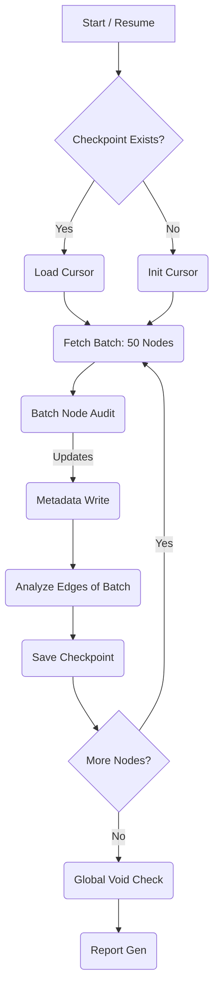

# System Design: Context Audit Utility ("The Deep Dive") - V2
**Author**: Antigravity (Principal Engineer)
**Date**: 2026-01-10
**Status**: PROPOSED FINAL
**Reference**: `00_Prompt_from_Brian.md`, `02_design_review.md`

## 1. Executive Summary
We will build a high-performance, resilient CLI utility, `audit_context`, designed to perform a comprehensive "MRI Scan" of the Context Graph.
**V2 Update**: Defines a **Streaming & Batching** architecture to handle large graphs without OOM crashes or prohibitive API costs.

## 2. System Architecture

### 2.1 Components
-   **`ContextAuditor` (Orchestrator)**: Manages the `AuditCursor` and the `BatchProcessor`.
-   **`AuditCursor`**: Tracks progress through the graph (Page N of X), supporting **Resumability** via `checkpoint.json`.
-   **`BatchProcessor`**: Aggregates items (Nodes/Edges) into chunks (e.g., 20) for optimized LLM processing.
-   **`AuditLogger`**: A file-stream logger (via `winston`) that avoids unlimited memory buffering.
-   **`MetricStore`**: In-memory aggregator for KPIs, flushed to disk periodically.
-   **`AuditDashboard`**: A Terminal User Interface (TUI) providing real-time visibility.
    *   **Tech**: Typescript + `ink` (React for CLI).
    *   **Displays**: Progress Bars (Node Phase, Edge Phase), Live KPI Counters (Nonsense Nodes, Missing Edges), and a scrolling log of "Latest Flags".

### 2.2 Data Flow (Streaming)

## 3. Implementation Details

### 3.1 LLM Optimization (Micro-Batching)
To solve the "6,000 API Calls" problem, we will use **List-based Analysis**.
*   **Input**: JSON List of 20 Nodes `[{id, name, type}, ...]`.
*   **Prompt**: *"Review this list. Return the IDs of any node that is misclassified or semantically inconsistent, with a reason."*
*   **Gain**: Reduces API traffic by ~95%.

### 3.2 Edge Rationale & Embeddings
*   **Storage**: Since LanceDB doesn't natively support "Edge Tables", we will store Edge Rationale Embeddings in a local **SQLite** file (`audit_edge_vectors.sqlite`) or a flat `edge_vectors.json` (if <100MB).
*   **Linkage**: The `ContextEdge` metadata will store the `rationale_id` pointing to this external store.

### 3.3 The Pipeline Steps

#### Step 1: Initialization / Resume
*   Load `checkpoint.json` (stores `last_processed_node_id`, `kpi_counts`).
*   Open `audit.log` in append mode.

#### Step 2: Node Batch Audit (Loop)
*   Fetch 20 Nodes.
*   **LLM Call**: "Analyze List for Consistency".
*   Update `audit_consistency_score` in DB for flagged nodes.
*   Log results.

#### Step 3: Edge Logic (Per Node Batch)
*   For the 20 nodes, fetch outgoing edges.
*   **LLM Call**: "Generate Narrative for these 5 edges" (Batch).
*   **Embed**: Calculate vector for narratives.
*   Store: Write to `audit_edge_vectors.sqlite`.

#### Step 4: Void & Duplicate Detection (Global Phase)
*   *Note: Requires full graph index.*
*   Load Node Vectors into memory (or use LanceDB index).
*   Sample: For top 10% highest-weight nodes, query N=40 neighbors.
*   **Void Check**: If no edge exists, ask "Should this edge exist?" -> `EdgeFalseNegativeRate`.
*   **Duplicate Check**: 
    1.  Filter neighbors where `CosineSimilarity > 0.85` (Lower threshold to catch "soft" duplicates).
    2.  **Prompt**: *"Are '{NodeA}' and '{NodeB}' referring to the exact same entity or concept? Should they be merged? Consider their Descriptions: {DescA} / {DescB}."*
    3.  **Action**: If YES, flag as `DuplicateCandidate`.
    4.  **KPI**: `DuplicateNodeCount`.

#### Step 5: Meta-Analysis
*   Feed summary statistics, "Top 10 Flagged Items", and "Top 10 Duplicates" to LLM for pattern recognition.

## 4. Test Plan

### 4.1 Unit Tests (`src/test/audit/`)
*   **`Batching.test.ts`**: Verify `BatchProcessor` correctly chunks 105 items into 5 batches of 20 + 1 batch of 5.
*   **`Resumability.test.ts`**:
    1.  Run mock audit, kill process at 50%.
    2.  Restart.
    3.  Verify it resumes at 51% (check `last_processed_id`).
*   **`EdgeVectorStore.test.ts`**: Verify SQLite/JSON read/write for edge embeddings.

### 4.2 Integration ("The Golden Set")
*   **File**: `tests/fixtures/golden_profile_brian.txt`.
*   **Script**: `GoldenJudge.ts`.
*   **Logic**:
    *   Ingest Profile.
    *   Run Audit.
    *   Ask Q: "Who is Brian?".
    *   Compare Answer against Golden Answer using Semantic Similarity (Embedding Cosine > 0.9).

## 5. Security & Safety
*   **Rate Limits**: Enforce strict sleep (100ms) between batches to prevent `429 Too Many Requests`.
*   **Budget Cap**: Hard stop if Estimated Cost > $5.00.

## 6. Artifacts
*   `context_audit_test/src/` (Source)
*   `context_audit_test/data/` (Checkpoints, SQLite)
