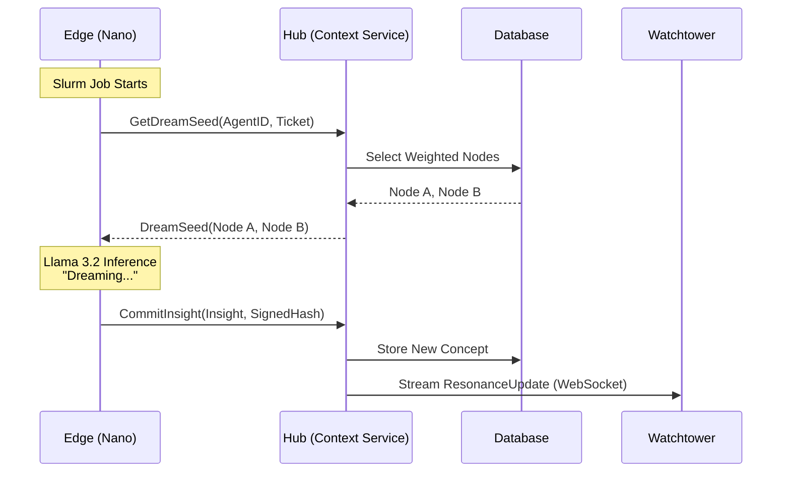

# Distributed Context Management & "Dream" Orchestration

## 1. System Topology

The system is divided into three functional layers based on your hardware capabilities:

*   **The Hub (Mac Studio/PC):** Runs the **Centralized Context Service** (Option 2) and the **Rust Resonator**. It handles high-compute tasks like PageRank and Louvain clustering.
*   **The Edge (Jetson Nanos):** Runs the **"Dream Weaver"** (REM mechanism). These act as Agent-Centric "Sidecars" (Option 3) that request node pairs from the Hub to process locally.
*   **The Watchtower (UI):** A web-based REPL and MindMapper visualization that allows you to securely monitor resonance energy and dreaming logs in real-time.

```mermaid
graph TD
    subgraph Edge ["The Edge (Jetson Nanos)"]
        Nano[("Dream Weaver<br/>(Llama 3.2)")]
    end

    subgraph Hub ["The Hub (Mac Studio/PC)"]
        CCS[Context Service]
        Resonator[Rust Resonator]
        DB[(PostgreSQL + pgvector)]
    end

    subgraph User ["The Watchtower (UI)"]
        Visualizer[MindMapper REPL]
    end

    Nano <-->|gRPC (Munge)| CCS
    CCS <--> Resonator
    CCS <--> DB
    Resonator -->|WebSocket (JWT)| Visualizer
```

## 2. Authentication & Secure "Watching"

To "watch" the dream securely across your network, we implement a **Ticket-Based Authentication** system. This prevents unauthorized nodes (or external actors) from injecting "false memories" or snooping on agent internal states.

### 2.1 The "Munge" Foundation
Since you are using a Slurm cluster, we leverage **MUNGE** (Mesh Unified Network G-E-N-E-R-A-T-O-R) for inter-node authentication.

> **Requirement:** Every request from a Nano to the Hub must include a Munge-signed credential in the gRPC metadata.

*   The Hub verifies the UID/GID to ensure the request came from a trusted "Brian" process on your network.

### 2.2 JWT for Visualizer Access
For the Web UI/Watchtower, we use **JSON Web Tokens (JWT)**:

1.  **Login:** You authenticate once via the Hub (using a simple secret or SSH-key based auth).
2.  **Streaming:** The Hub issues a JWT with `VIEW_DREAM` permissions.
3.  **Observation:** Your browser opens a WebSocket to the Resonator service, passing the JWT. The Hub only streams `ResonanceEvents` if the token is valid.

## 3. Distributed Workflow: The "Dream" Cycle

### Phase 1: The Request (Edge to Hub)
A Jetson Nano, running a "Sleep Job" scheduled by Slurm, requests a Dream Seed from the Hub.

*   **Nano:** `rpc GetDreamSeed(AgentID) returns (NodePair)`
*   **Hub:** Runs a probability-weighted selection of "Recent" or "High Energy" nodes.

### Phase 2: The REM State (Local on Nano)
The Nano performs the heavy LLM inference locally to save network bandwidth.

1.  It spins up a 1B model (Llama 3.2).
2.  It executes the Dream Weaver logic: *"How do {Node A} and {Node B} connect?"*
3.  **Security:** The Nano creates a hash of the result, signed by its local Munge key.

### Phase 3: Consolidation (Hub)
The Nano pushes the new insight back to the Hub.

*   **Nano:** `rpc CommitInsight(NewNode, SignedHash)`
*   **Hub:** Verifies the hash, adds the node to the PostgreSQL + pgvector store, and triggers the Rust Resonator to update global significance.



## 4. Interface Definitions (`distributed_context.proto`)

```protobuf
syntax = "proto3";
package context.distributed.v1;

service ContextOrchestrator {
  // Edge nodes (Nanos) request work
  rpc GetDreamSeed (DreamRequest) returns (DreamSeed);

  // Edge nodes report new insights found during REM
  rpc CommitInsight (InsightReport) returns (CommitStatus);

  // The Visualizer (Watchtower) streams live resonance
  rpc WatchResonance (WatchRequest) returns (stream ResonanceUpdate);
}

message DreamRequest {
  string agent_id = 1;
  string munge_ticket = 2; // Security: Munge-signed UID/Timestamp
}

message DreamSeed {
  string node_a_id = 1;
  string node_a_text = 2;
  string node_b_id = 3;
  string node_b_text = 4;
  float temperature = 5; // e.g., 1.2 for REM, 0.2 for SWS
}

message InsightReport {
  string agent_id = 1;
  string content = 2; // The newly generated "Dream Insight"
  repeated string parent_ids = 3; // Links back to Seed nodes
  string munge_ticket = 4;
}

message WatchRequest {
  string jwt_token = 1; // Security: JWT for the Web UI
  string agent_id = 2;
}

message ResonanceUpdate {
  string event_type = 1; // "NODE_FIRE", "NEW_LINK", "DREAM_SPAWN"
  string description = 2; // The log/text of what just happened
  float energy_level = 3;
}
```

## 5. Implementation Roadmap for Your Repo

- [ ] **Munge Setup:** Ensure your Mac Studio and Nanos share the same `/etc/munge/munge.key`.
- [ ] **The Sidecar:** Create a small Python wrapper on the Nano that calls `ollama` and talks to your Hub via the proto above.
- [ ] **The Watchtower:** Update your `ContextVisualizer` to subscribe to the `WatchResonance` stream. This allows you to see *"Node A + Node B = Node C"* appear in the MindMapper graph in real-time.