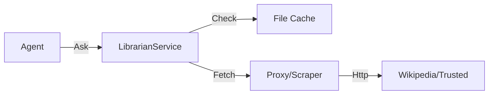

# Phase 19: System Feedback & The Librarian

## 1. Overview
This phase implements two meta-cognitive features:
1.  **System Feedback**: A channel for agents to communicate with the system/developers about unhandled intentions or simulation parameters.
2.  **The Librarian**: A research utility that allows agents to fetch external knowledge from trusted sources (Wikipedia), with caching and rate limiting.

## 2. Feature 1: System Feedback

### 2.1 Concept
Agents often express desires that don't fit into `TALK_TO` or `THINK_ABOUT`. We capture these as `SYSTEM_FEEDBACK` nodes.
Typical triggers: "I wish I could paint", "I need to access the internet", "I want to change the topic to X but can't".

### 2.2 Data Model
-   **Type**: `NodeType.SYSTEM_FEEDBACK` (New Enum value).
-   **Payload**:
    -   `text`: The raw feedback.
    -   `metadata.reason`: Why they want this.
    -   `metadata.urgency`: 1-5.

### 2.3 Implementation
1.  **Intention Extraction**:
    -   Update `simulate_conversation.ts` (Intention Prompt) to include `SYSTEM_FEEDBACK` as a valid JSON output.
2.  **Storage**:
    -   Stored in the agent's graph like any other node.
    -   Does *not* decay (pinned).
3.  **UI & REPL**:
    -   REPL: `!feedback [participantId]` -> Lists all feedback nodes.
    -   API: `GET /api/feedback/:participantId`

## 3. Feature 2: The Librarian (Research Proxy)

### 3.1 Concept
An "Outbound" tool for agents to learn. Instead of hallucinating, they query the Librarian.

### 3.2 Architecture


### 3.3 Components
1.  **LibrarianService**:
    -   **Cache**: `context_service/data/librarian_cache/{hash}.json`. 
    -   **Rate Limiter**: 1 request per 5 seconds globally to avoid bans.
    -   **Parser**: `cheerio` or `JSDOM` to extract main text from HTML.

2.  **Allowed Sources**:
    -   `wikipedia.org`
    -   `arxiv.org` (Abstracts)
    -   `github.com` (Readmes)

3.  **Agent Tool**:
    -   New Intention: `LEARN_MORE [Topic]`.
    -   Action: Simulation Script calls `LibrarianService.research(topic)`.
    -   Result: Ingested as a `KNOWLEDGE` node.

## 4. Scaling Strategy (Future)

> [!NOTE]
> The current FS-based cache works for single-node deployments but will hit locks on distributed runs.

### 4.1 Proposed "Librarian Node" Architecture
Transition `LibrarianService` from an in-process class to a dedicated Microservice container.

**Docker Compose**:
```yaml
services:
  librarian:
    image: social-sim/librarian:latest
    volumes:
      - librarian_cache:/app/cache
    ports:
      - "8085:8085"
    networks:
      - sim_net

  redis:
    image: redis:alpine
    command: redis-server --appendonly yes
    volumes:
      - redis_data:/data
```

**Workflow**:
1.  **Request**: ContextService sends gRPC/HTTP to `http://librarian:8085/research`.
2.  **Cache**: Librarian checks Redis (Primary) -> Disk (Fallback).
3.  **Fetch**: If miss, Librarian makes external request.

### 4.2 Commentary: Principal Engineer
> **@PrincipalEngineer**: 
> "Moving the Librarian to a dedicated container is the right call for avoiding the 'Monolith Trap', but let's not over-engineer the caching layer too early. 
> 
> * Redis is great for speed, but our bottleneck is the **External API Rate Limit** (Wikipedia), not disk I/O.
> * A shared Docker Volume (`librarian_cache`) mounted to the Librarian container is sufficient for now and simpler to debug than Redis persistence.
> * **Recommendation**: Dockerize the Librarian service to isolate its network traffic (easier to monitoring egress), but stick to file-system caching until we hit >100 agents concurrent. At that point, swap the file adapter for Redis without changing the API contract."

## 5. Security & Performance
-   **SSR/XSS**: The Proxy must sanitize HTML before passing text to the LLM or storing it.
-   **Cache**: Crucial for testing. We don't want tests hitting Wikipedia.
